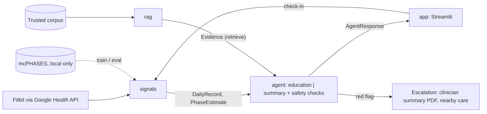

# Architecture

> **Status: draft for discussion, not final.** This is a starting proposal. Before implementing
> anything that depends on an unsettled part (open items in [decisions.md](decisions.md), or
> anything that changes this diagram or a contract), raise it with the team at standup or in an
> issue. Record the outcome in decisions.md, then update this page.

## How the layers connect

All handoffs are Pydantic models in `contracts/models.py`. Example payloads are in `contracts/fixtures/`.

| Handoff | Contract | Entry point |
|---|---|---|
| signals → agent | `DailyRecord`, `PhaseEstimate` | `get_daily_records(user_id)`, `estimate_phase(user_id)` |
| rag → agent | `Evidence` | `retrieve(query, user_context) -> list[Evidence]` |
| agent → app | `AgentResponse` | `respond(question, user_id, mode)` |

Every contract carries a `source` (`real` / `synthetic` / `mixed`) so the UI can label it.
`AgentResponse.fallback_used` marks answers served from cached or canned paths.

## Stubbed vs real

Update at each integration gate (Nov 15, Nov 19, Dec 4).

| Component | Status | Notes |
|---|---|---|
| Contracts + fixtures | real | v0.1 |
| signals: records + phase estimate | stub | fixture data, synthetic |
| signals: synthetic Maya | real | `signals.synthetic` + `data/synthetic/maya.json`: 158 days, 4 cycles + a late current cycle, from mcPHASES aggregates (see docs/data.md). The app's demo user reads it, dated to end today; her phase is #9's calendar estimate on her check-ins. |
| signals: luteal-rise detector | real, not wired | `signals.detector`: temperature, RHR and HRV vs her own 28-day baseline, look-back only (D15, D34). Held-out eval in `evals/signals/run.py`. `estimate_phase` doesn't use it yet (waits on PR #9's `signals/cycle.py`). |
| signals: mcPHASES records | real | `signals.mcphases_records`: cleaned `DailyRecord`s + phase labels for offline evals only (see docs/data.md) |
| signals: Google Health client | real | pulls and caches raw Fitbit data; not yet parsed into `DailyRecord` (see docs/data.md) |
| rag: retrieve | real, not wired | `rag.retriever`: BM25 over all 60 manifest docs (1,314 chunks), real citations. The agent still imports `rag.stub` until the fertility guard (D25) exists. |
| agent: respond | stub | wires stubs; no LLM, no routing, no safety checks yet |
| app | partial | Today (Cycle Clock, source, coverage, limit), check-in with Undo, Ask, and failure/red-flag previews. The demo user shows synthetic Maya with a calendar phase; the Today card is driven by the phase (D34 proposal), and the nights chart shows the last 7 nights. Check-ins last one session (D13). Red-flag, sync and fallback states are demo previews until the router and fallbacks exist. |
| evals: rag | partial | 56 questions, 32 dev references; `python -m evals.rag.run` gives Hit@5 and capped Recall@5. Answer metrics wait for generation (see `evals/rag/README.md`). |
| evals: signals | real | `python -m evals.signals.run`: held-out balanced accuracy 0.64, 95% CI 0.55–0.73 (luteal vs not, Mira labels), coverage 0.61, median lag 2 days. See `evals/signals/README.md` |
| evals: agent | not started | planned metrics in the timeline's Sprint 2 row |
| Storage | not started | open decision |
