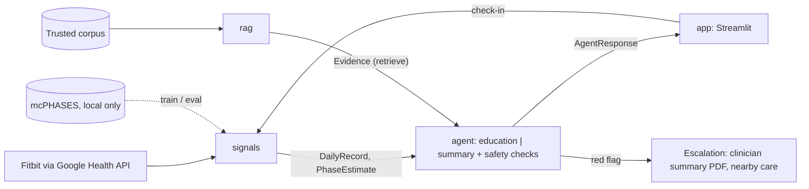

# Architecture

> **Status: draft for discussion, not final.** This is a starting proposal. Before implementing
> anything that depends on an unsettled part (open items in [decisions.md](decisions.md), or
> anything that changes this diagram or a contract), raise it with the team at standup or in an
> issue. Record the outcome in decisions.md, then update this page.

## How the layers connect

All handoffs are Pydantic models in `contracts/models.py`. Example payloads are in `contracts/fixtures/`.

| Handoff | Contract | Entry point |
|---|---|---|
| signals → agent | `DailyRecord`, `PhaseEstimate` | `get_daily_records(user_id)`, `estimate_phase(user_id)` |
| rag → agent | `Evidence` | `retrieve(query, user_context) -> list[Evidence]` |
| agent → app | `AgentResponse` | `respond(question, user_id, mode)` |

Every contract carries a `source` (`real` / `synthetic` / `mixed`) so the UI can label it.
`AgentResponse.fallback_used` marks answers served from cached or canned paths.

## Stubbed vs real

Update at each integration gate (Nov 15, Nov 19, Dec 4).

| Component | Status | Notes |
|---|---|---|
| Contracts + fixtures | real | v0.1 |
| signals: records + phase estimate | stub | fixture data, synthetic |
| signals: Google Health client | real | pulls and caches raw Fitbit data; not yet parsed into `DailyRecord` (see docs/data.md) |
| rag: retrieve | real | `rag.retriever`: BM25 over all 60 manifest docs (1,314 chunks), real citations. Wired into `agent.router` for "education" mode, falling back to `rag.stub`'s canned fixture (`fallback_used=True`) if the corpus hasn't been fetched locally (`python -m rag.corpus`). |
| agent: respond | partial | `agent.router`: fertility guard (D25) and red-flag/caution rules v1 (D5, proposed as D29) are live and run before retrieval. No LLM (D8's model name, D14 open), so education answers are retrieval plus a template, not generated prose. "summary" mode still calls `agent.stub` (D7, D14 open). |
| app | partial | Today (Cycle Clock, source, coverage, limit), check-in with Undo, Ask (now backed by `agent.router`), and failure/red-flag previews. Check-ins last one session (D13). Sync and fallback states are demo previews; the red-flag state also fires for real from the chat input. |
| evals: rag | partial | 56 questions, 32 dev references; `python -m evals.rag.run` gives Hit@5 and capped Recall@5. Answer metrics wait for generation (see `evals/rag/README.md`). |
| evals: signals, agent | not started | planned metrics in the timeline's Sprint 2 row |
| Storage | not started | open decision |
